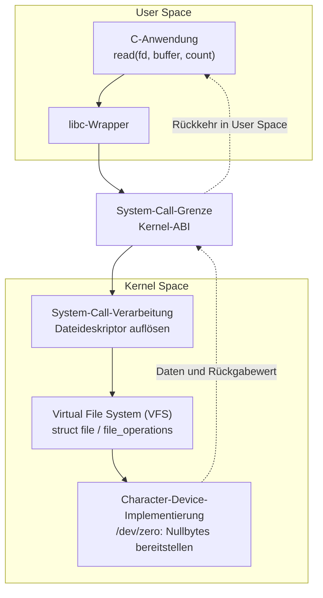

# Linux-Kernel und Embedded Linux – Nachschlagewerk

Dieses Dokument erklärt die fachlichen Grundlagen unseres Lernpfads. Neue Themen ergänzen die bestehenden Kapitel und beziehen sich auf dieselben Beispiele. Es ist kein Fortschrittsprotokoll. Versionsabhängige Befehle und APIs werden bei ihrer praktischen Verwendung gegen die verwendete Kernel-Version geprüft.

## 1. Das System als Ganzes

Ein Linux-Gerät besteht aus mehreren Ebenen, die unterschiedliche Aufgaben haben:

| Ebene | Aufgabe | Beispiel |
| --- | --- | --- |
| Anwendung im User Space | Fachliche Funktion | Gateway-Prozess sammelt Messwerte |
| User-Space-Bibliothek und Kernel-ABI | Stabile Schnittstelle zum Kernel | libc `read()`, System Call, `ioctl`, Socket |
| Kernel-Subsystem | Gemeinsame Dienste und Regeln | VFS, Netzwerkstack, Device Model |
| Gerätetreiber | Bindeglied zu einem Gerät | UART-, SPI- oder Sensortreiber |
| Hardware | Physisches Gerät | SoC, UART-Controller, Sensor |

Der Bootloader lädt zuvor den Kernel und die nötigen Startdaten; ein Root-Dateisystem liefert Programme und Konfiguration. Diese Startkette wird später separat untersucht.

**Wichtige Grenze:** Eine User-Space-Anwendung ruft normalerweise keine internen Kernel-Funktionen auf. Sie verwendet eine vom Kernel bereitgestellte ABI, etwa System Calls und Geräte- oder Netzwerk-Schnittstellen. Ein Kernel-Modul verwendet dagegen Kernel-interne APIs. Eine Bibliotheksfunktion wie `read()` kann einen System Call auslösen; Bibliotheksfunktion, System Call und Treiberfunktion sind drei verschiedene Dinge.

## 2. Ein roter Faden: vom `read()` zum Gerät

Ein Prozess ruft `read(fd, buffer, count)` auf. Für eine passende Gerätedatei läuft der Zugriff vereinfacht so:

```text
Anwendung → libc/System Call → Kernel/VFS → Treiber-Operation → Gerät
```

Der Dateideskriptor `fd` bezeichnet eine bereits geöffnete Datei beziehungsweise einen offenen Kernel-Dateikontext. Das VFS stellt ein einheitliches Dateimodell bereit und leitet die Operation an die zuständigen Implementierungen weiter. Ein Gerätetreiber kann für ein Character Device entsprechende `file_operations` bereitstellen. Beim Rückweg gelangen Daten kontrolliert in einen User-Space-Puffer. Ein `read()` auf einer gewöhnlichen Datei nimmt einen anderen Pfad, etwa über ein Dateisystem und gegebenenfalls Block-I/O; das Schema ist bewusst vereinfacht.

Daraus ergeben sich unsere Leitfragen: Wer erstellt beziehungsweise findet das Gerät? Woher kennt der Treiber seine Hardware-Ressourcen? In welchem Kontext läuft die Operation? Wie kommen Daten sicher über die User/Kernel-Grenze? Was passiert beim Booten, und wie gelangen Anwendung und Treiber in das Image?

## 3. Begriffe, die wir auseinanderhalten

| Begriff | Bedeutung und Abgrenzung |
| --- | --- |
| Kernel Space | Privilegierter Ausführungskontext des Kernels; User Space ist durch Speicher- und Privileggrenzen getrennt. |
| Kernel-ABI | Nach außen sichtbare Schnittstellen für User Space, darunter System Calls; Details einzelner Schnittstellen haben eigene Stabilitätsregeln. |
| Kernel-interne API | Funktionen und Strukturen für Kernel-Code; bei Versionswechseln können Änderungen nötig werden. |
| Kernel-Modul | Nachladbarer Kernel-Code (`.ko`); muss kein Hardwaretreiber sein. Ein Treiber kann auch fest einkompiliert sein. |
| Device Driver | Code, der ein Gerät in passende Kernel-Subsysteme einbindet. |
| Device Model | Modell für Geräte, Treiber, Busse, Klassen und Bindung; in `/sys` teilweise sichtbar. |
| Device Tree | Hardwarebeschreibung vor allem für Plattformen, deren Geräte nicht vollständig selbst entdeckt werden; kein Ersatz für den Treiber. |
| `/dev` | Üblicher Ort für Geräteknoten, über die Anwendungen bestimmte Geräte-Schnittstellen öffnen. |
| `/sys` | sysfs-Sicht auf Kernel-Objekte und Attribute, insbesondere Geräte und Treiber. |
| `/proc` | Schnittstelle für Prozess- und weitere Kernel-Informationen. |
| debugfs | Diagnose-Schnittstelle ohne stabile User-Space-ABI; ungeeignet als Produkt-ABI. |
| rootfs/initramfs | Dauerhaftes Root-Dateisystem beziehungsweise optionales frühes Dateisystem im RAM für die Startphase. |

Die [Repository-Struktur](REPOSITORY_STRUCTURE.md) ordnet die folgenden Stufen ihren Übungsverzeichnissen zu.

## 4. Lernpfad und Verbindung der Stufen

Jede Stufe beantwortet eine zusätzliche Frage zum selben Gesamtsystem. Die praktischen Ergebnisse werden in den zugehörigen Fachkapiteln erklärt und durch reproduzierbare Übungen überprüft.

| Stufe | Frage | Konzept und praktisches Ergebnis |
| --- | --- | --- |
| **0 – Entwicklungsumgebung** | Wo können wir Kernel-Code sicher bauen und starten? | Windows/WSL2 als Arbeitsumgebung; QEMU-Gast als getrenntes Testsystem; reproduzierbarer Start, Konsole und Rückweg. |
| **1 – Architektur und Begriffe** | Was läuft wo? | User/Kernel-Grenze, ABI/API, System Call, VFS, `/dev`, `/sys`, `/proc`; `read()` verfolgen. |
| **2 – Kernel-Build** | Woher kommt der laufende Kernel? | Source Tree, Kconfig, kbuild, Konfiguration, Image und Module; eigenen Kernel in QEMU booten. |
| **3 – Module** | Wie gelangt eigener Code in den Kernel? | Externes Modul bauen, laden, protokollieren und entfernen; Version und Laufzeitumgebung beachten. |
| **4 – Kernel ↔ User Space** | Wie trifft ein bekannter User-Space-Aufruf auf eigenen Kernel-Code? | Character Device und kleine Testanwendung; zunächst `open/read/write`, später bei Bedarf `poll/ioctl`; Fehler- und Datenpfade nachvollziehen. |
| **5 – Device Model** | Wie finden Gerät und Treiber zueinander? | Bus, Device, Driver, `probe/remove`, Platform Driver und sysfs. |
| **6 – Device Tree** | Woher stammen nicht automatisch erkennbare Hardwaredaten? | DT-Beschreibung, `compatible`, Ressourcen und Bindung an einen geeigneten Treiber; zunächst emuliert oder mit geeigneter Hardware. |
| **7 – Nebenläufigkeit und Hardwarezugriff** | Was ändert sich durch Interrupts und mehrere Ausführungskontexte? | Kontext, IRQ, Workqueue, Locking, MMIO und später DMA anhand konkreter Treiberfälle. |
| **8 – Bootkette** | Wie kommen Kernel, DTB und Root-Dateisystem ins System? | Boot ROM, optional SPL, U-Boot, Kernel, initramfs/rootfs, init; serielle Konsole und Fehlersuche. |
| **9 – Image-Erzeugung** | Wie entsteht ein reproduzierbares Gerät? | Erst ein überschaubares Buildroot-System, danach Yocto-Grundlagen; Anwendung und gegebenenfalls Modul integrieren. |
| **10 – IoT-Gateway** | Wie arbeiten die Teile im Produkt zusammen? | Sensordatenpfad, Dienststart, Logging, Netzwerk und MQTT; Hardware- und Systemschnittstellen begründet wählen. |
| **Vertiefung** | Wie betreibt und schützt man viele Geräte? | Netzwerkdiagnose, OTA/A-B und Rollback, Secure Boot und Vertrauenskette. |

Die Aufgaben für das Embedded-IoT-Gateway geben die Priorität vor: Boot und Kernel-Konfiguration, Device Tree, Images, Netzwerk und Betrieb erhalten ebenso praktische Aufmerksamkeit wie Module und Treiber. Ein eigener Kernel-Treiber wird dort eingesetzt, wo eine Kernel-Schnittstelle tatsächlich nötig ist; ein per UART ansprechbarer Sensor lässt sich je nach Anforderungen auch sinnvoll aus User Space bedienen.

### Stufe 0: Aufbau und Abnahmekriterien

Die Arbeitsumgebung nutzt Windows mit WSL2 Ubuntu für Quellen, Build und Werkzeuge sowie einen QEMU-Gast für den selbst gebauten Testkernel. Der Gast ist das Testziel: Kernel-Abstürze beeinträchtigen so nicht den Arbeitskernel in WSL2. Zu Beginn prüfen wir vorhandene WSL2-, Compiler-, Build-, QEMU- und Speicherressourcen und halten die tatsächlich verwendeten Versionen fest. Dann richten wir mit einem vorbereiteten Linux-System einen einfachen Start über eine serielle Gastkonsole, ein geeignetes Root-Dateisystem und einen klaren Weg zum Herunterfahren/Neustarten ein. Der eigene Kernel-Build folgt in Stufe 2; das externe Modul und die Zuordnung zu den passenden Kernel-Build-Artefakten folgen in Stufe 3.

Die Stufe ist abgeschlossen, wenn der Gast reproduzierbar bootet, seine Kernel-Version erkennbar ist, Kernel-Meldungen auf der Konsole sichtbar sind und ein fehlgeschlagener Versuch durch einen Neustart des Gasts behoben werden kann. ARM-SoC, echte serielle Board-Konsole und U-Boot folgen später, wenn ihre Rolle im Gesamtsystem eingeführt ist.

### Stufe 1: Linux-Systemarchitektur und Grundlagen

Der durchgehende Leitfall ist ein `read()` aus einer C-Anwendung auf `/dev/zero`. Das Diagramm zeigt die **logische** Verarbeitung vom User Space über die System-Call-Grenze zum Kernel und zurück. Es stellt nicht die exakte Funktionsaufrufkette einer bestimmten Kernel-Version dar; `/dev/zero` erzeugt die gelesenen Nullbytes ohne externe Hardware.



Die Abschnitte bauen aufeinander auf; **Theorie und allgemeine Zusammenhänge** werden in diesem Nachschlagewerk ergänzt. **Befehle, praktische Prüfungen und bestätigte Ergebnisse** werden in `labs/01-system-architecture/README.md` dokumentiert. Für jedes Experiment sind Umgebung (Ubuntu/WSL2/Bash oder Alpine/QEMU/ash), Voraussetzungen, Soll-Ergebnis und Validierung zu benennen.

| Abschnitt | Technischer Schwerpunkt / Lernziel | Geplantes Experiment im Alpine-Gast |
| --- | --- | --- |
| **1.1 – Systemarchitektur und Schutzgrenzen** | Kernel-Aufgaben und Subsysteme; User/Kernel Space, CPU-Privilegien, MMU, Prozessadressräume | Kernel- und Prozessinformationen unter `/proc` gegenüberstellen |
| **1.2 – System Calls, libc und ABI** | C-Bibliotheksaufruf vs. System Call; Fehler/`errno`; `read()`, `write()` und `ioctl()` inklusive Request und Argumenten | Kleines C-Programm; `strace` für `read()` und `ioctl()` (z. B. `FIONREAD` auf einer Pipe); Fehlerfall |
| **1.3 – Dateideskriptoren und VFS** | `fd`, Open-File-Description, `struct file`, Inode, Dentry und `file_operations`; Datei-Offsets | `open()`/`dup()`/`read()` vergleichen; `/proc/<PID>/fd` und `fdinfo` prüfen |
| **1.4 – Dateitypen und virtuelle Dateisysteme** | Reguläre Dateien, procfs, sysfs, Geräteknoten und Mountpoints unterscheiden | Leseoperationen auf `/etc`, `/proc`, `/sys` und `/dev` vergleichen |
| **1.5 – Geräte, Treiber und Device Model** | Character/Block Devices, Major/Minor, `/dev`, Bus-/Treiberbindung, sysfs; `ioctl()` im Gerätepfad | `/dev/zero`, `/dev/ttyS0`, `/dev/vda` und zugehörige sysfs-Einträge untersuchen |
| **1.6 – Boot- und Prozessarchitektur** | Bootloader → Kernel → Root-Dateisystem → PID 1 → Dienste/Shell; Prozesse und Scheduling-Grundlagen | `/proc/cmdline`, PID 1, `/etc/inittab`, OpenRC-Dienste und Prozesshierarchie prüfen |
| **1.7 – End-to-End-Pfad und Abnahme** | User-/Kernel-Grenze, VFS und Treiberoperation an einem Datenpfad zusammenführen | `read()` von `/dev/zero` nachvollziehen und mit regulärer Datei und procfs vergleichen |

**Einordnung von `ioctl()`:** Abschnitt 1.2 erklärt die System-Call-Schnittstelle, Request-Codes, Datenargumente und die ABI. Abschnitt 1.5 ordnet sie dem Geräte- und Subsystempfad zu. Eine eigene `.unlocked_ioctl`-Implementierung, `_IO`-/`_IOR`-/`_IOW`-/`_IOWR`-Definitionen und Details des sicheren User-/Kernel-Datentransfers werden erst beim Character Device in **Stufe 4** praktisch umgesetzt.

**Einordnung von OpenRC:** OpenRC ist nicht Alpine-spezifisch, sondern ein eigenständiges Service- und Init-Management-System. In der üblichen Alpine-Konfiguration ist **BusyBox `init` PID 1** und führt OpenRC-Skripte aus; OpenRC ist damit nicht automatisch selbst PID 1. Die tatsächlich laufende Implementierung wird in Abschnitt 1.6 überprüft. Die detaillierte Bootkette folgt wie geplant in Stufe 8.

**Voraussetzungen für Stufe 3/4:** Vor dem ersten einfachen Kernel-Modul benötigen wir Schutzgrenzen, Kernel-/User-API-Unterschied, Prozesskontext und (aus Stufe 2) den passenden Kernel-Build. Vor dem eigenen Character Device müssen insbesondere `fd`, VFS, `file_operations` und User-/Kernel-Speichertransfer vertieft werden. Interrupts, DMA, Device Tree und Yocto sind dafür noch nicht nötig.

Referenzen: [Linux VFS](https://docs.kernel.org/filesystems/vfs.html), [Linux `ioctl`-Schnittstellen](https://docs.kernel.org/driver-api/ioctl.html), [`read(2)`](https://man7.org/linux/man-pages/man2/read.2.html), [Alpine OpenRC](https://wiki.alpinelinux.org/wiki/OpenRC), [OpenRC User Guide](https://github.com/OpenRC/openrc/blob/master/user-guide.md).

## 5. Ausbauprinzip dieses Nachschlagewerks

Neue Fachkapitel verwenden möglichst denselben Datenpfad: zuerst die beobachtbare User-Space-Schnittstelle, dann Kernel-Subsystem und Treiber, danach Gerätebindung, Hardwarebeschreibung, Boot und Image. Jedes Kapitel soll Zweck, Einordnung, zentrale Begriffe, ein kleines lauffähiges Beispiel, typische Fehler sowie Bezüge zu bereits erklärten Ebenen enthalten. Kommandos und Code werden erst mit der passenden Übung konkretisiert und mit der jeweils verwendeten Version abgeglichen. Ergebnisse einzelner Durchläufe und persönliche Fortschrittsstände gehören nicht in dieses Dokument.

## 6. Stufe 0 – Entwicklungsumgebung einrichten

### 6.1 Rollen der Systeme

| Umgebung | Rolle | Dort ausgeführte Arbeit |
| --- | --- | --- |
| Windows | Physischer Entwicklungsrechner und Oberfläche | PowerShell, Terminal, VS Code |
| Ubuntu in WSL2 | Linux-Entwicklungsumgebung; Host für QEMU | Quellen bearbeiten, Programme und später Kernel bauen, QEMU starten |
| Linux in QEMU | Separates Testziel mit eigenem Kernel und User Space | Boot beobachten, später eigene Kernel und Module ausführen |

QEMU läuft als User-Space-Programm in WSL2 und stellt dem Gast eine Maschine mit CPU, Speicher und Geräten zur Verfügung. Ein Kernel-Absturz im Gast beendet oder blockiert dessen Betrieb; der WSL2-Arbeitskernel bleibt normalerweise weiter benutzbar. WSL2 und der QEMU-Gast besitzen voneinander getrennte Kernel. Deshalb beziehen sich Befehle wie `uname -r` und später `insmod` immer auf die Umgebung, in deren Shell sie ausgeführt werden.

**TCG** ist QEMUs Software-Emulation der CPU. **KVM** nutzt unter Linux Hardwarevirtualisierung. KVM kann deutlich schneller sein; seine Nutzbarkeit innerhalb von WSL2 hängt von der Rechner- und WSL-Konfiguration ab. Für den Einstieg ist TCG ein möglicher Weg ohne KVM. Ein vorhandenes `/dev/kvm` ist ein erster Hinweis, aber noch kein erfolgreicher Funktionstest. Wir prüfen einen konkreten QEMU-Start später separat.

`/dev/kvm` ist ein **Character Device**: Über diesen Geräteknoten kann ein User-Space-Prozess mit der KVM-Schnittstelle des Linux-Kernels kommunizieren (unter anderem über `ioctl()`). Bei Zugriffsrechten wie `crw-rw---- root kvm` müssen unprivilegierte QEMU-Prozesse normalerweise zur Gruppe `kvm` gehören. Dabei sind drei Prüfungen zu unterscheiden: Existiert das Gerät? Hat der aktuelle Benutzer Zugriff? Lässt sich ein KVM-beschleunigter Gast tatsächlich starten? Erst die letzte Prüfung belegt die Nutzbarkeit.

### 6.1.1 Ressourcen und virtuelle Datenträger

Die WSL2-VM teilt sich die physischen Ressourcen mit Windows. Ohne abweichende Konfiguration begrenzt WSL2 den VM-Arbeitsspeicher standardmäßig auf ungefähr 50 % des Windows-RAM und stellt standardmäßig die logischen Prozessoren des Hosts bereit. Ein innerhalb von WSL2 gestarteter QEMU-Gast benötigt Speicher aus diesem Budget; Gast-RAM ist nicht zusätzlich vorhandener physischer RAM.

Das Linux-Root-Dateisystem einer WSL2-Distribution liegt üblicherweise in einer virtuellen Festplatte (VHDX). `df -h` zeigt den Dateisystemplatz innerhalb dieses Datenträgers; die virtuelle Maximalgröße ist nicht mit dem tatsächlich verfügbaren Platz des Windows-Laufwerks gleichzusetzen. Insbesondere wenn eine dynamisch wachsende VHDX erweitert wird, benötigt sie weiteren Platz auf dem Windows-Host.

Für die Paketinstallation dient APT als Paketverwaltung der Ubuntu-Entwicklungsumgebung. Paketindizes (`apt update`) und Paketinstallation (`apt install`) sind unterschiedliche Schritte. Das Paket `build-essential` bündelt unter anderem C-Compiler und `make`; QEMUs **Systememulator** bootet ein ganzes Gastsystem, während User-Mode-QEMU nur einzelne Fremdarchitektur-Programme ausführt.

Ubuntu stellt bestimmte Paketaktualisierungen als **phased updates** schrittweise bereit, um Regressionsrisiken zu reduzieren. Ein Eintrag wie `(phased 50%)` in der Paketübersicht bezeichnet den derzeitigen Verteilungsgrad der betreffenden Aktualisierung, nicht eine halb installierte Paketversion. Die konkrete APT-Transaktion und die nach der Installation per `dpkg-query` feststellbare Version sind maßgeblich; ein gezieltes `apt install` kann von einem allgemeinen `apt upgrade` abweichen. Die **Entwicklungswerkzeuge** gehören zum WSL2-Host und werden nicht automatisch im QEMU-Gast installiert.

Reguläre **Sicherheits- und Wartungsupdates** des Ubuntu-User-Space sind auch für WSL2 sinnvoll; Microsoft und Ubuntu empfehlen `apt update` und `apt upgrade`. `apt upgrade` aktualisiert installierte Distributionspakete innerhalb derselben Ubuntu-Version. Es ist kein Release-Upgrade und ersetzt nicht den Microsoft-WSL-Kernel. Auch ein Paket wie `linux-libc-dev` liefert Header für die Linux-**User-Space-ABI**, aber keinen neuen laufenden WSL-Kernel. Vor umfangreichen Systemupdates lässt sich die Pakettransaktion mit `apt -s upgrade` prüfen. Ein `apt full-upgrade` kann nötigenfalls Pakete entfernen und wird für die normale Pflege nicht pauschal verwendet. **Sicherheitsupdates** werden bei Ubuntu nicht phasenweise zurückgehalten; einige nicht sicherheitskritische Updates können vorübergehend zurückgestellt werden.

### 6.1.2 Paketintegrität und Aktualisierungswarnungen

APT verwaltet sowohl die Paketauswahl als auch die Installation, während `dpkg` die konkreten Pakete auspackt und konfiguriert. Nach umfangreichen Aktualisierungen prüft `dpkg --audit`, ob unvollständig installierte oder konfigurierte Pakete zurückgeblieben sind. Ein leeres Ergebnis ist hierbei der Normalfall. Mit `sudo -v` lässt sich vor weiteren administrativen Änderungen prüfen, ob der privilegierte Zugriff funktioniert. Auf einigen Distributionen kann das aufgerufene `sudo` über `update-alternatives` auf die Rust-Implementierung **sudo-rs** verweisen; ein solcher Pfad allein ist kein Fehler.

`update-alternatives` verwaltet austauschbare Programme über symbolische Verknüpfungen, zum Beispiel unterschiedliche Implementierungen des Befehls `sudo`. Ein während eines Paketupdates reparierter Link-Verbund bedeutet nicht automatisch, dass das aktualisierte Programm hinterher defekt ist; der tatsächliche Zustand muss kontrolliert werden.

Bei einer WSL2-Installation unterscheidet sich ein **Neustart der Ubuntu-Distribution** von einem **Herunterfahren aller WSL-Distributionen**. `wsl --terminate <Name>` beendet gezielt eine Distribution, während `wsl --shutdown` alle WSL-Instanzen einschließlich anderer laufender Anwendungen beendet. Vor einem Terminieren sollten laufende Prozesse in der betroffenen Distribution ordnungsgemäß beendet werden.

### 6.1.3 Benutzergruppen und KVM-Zugriff

Bei einem Character-Device-Knoten wie `/dev/kvm` steuern Dateibesitzer, Gruppe und Modus den normalen Dateizugriff. Die Gruppe `kvm` erlaubt bei einem Modus `crw-rw----` den Zugriff für ihre Mitglieder. `id -nG` zeigt die **aktiven Gruppenrechte eines Prozesses**, während `getent group kvm` den konfigurierten Gruppeneintrag liefert. Eine mit `usermod -aG` vorgenommene Änderung wird normalerweise erst in einer neuen Sitzung wirksam.

Der Zugriffstest `[ -r /dev/kvm ] && [ -w /dev/kvm ]` prüft nur Lesen und Schreiben nach den aktuellen Rechten. Der nächste unabhängige Nachweis ist der Start eines QEMU-Prozesses mit KVM-Beschleunigung. Für eine gezielte Diagnose kann QEMU mit `-accel kvm -S -monitor stdio` ohne Gast-Image initialisiert werden; im **QEMU-Monitor** (nicht in einer Linux-Gast-Shell) zeigen `info kvm` und `info accelerators` den Aktivierungszustand an. In einer Ausgabe wie `[kvm] mshv tcg` kennzeichnen die Klammern den aktiven Accelerator. Eine Warnung über das nicht verfügbare CPUID-Merkmal `svm` bezieht sich auf AMDs Virtualisierungserweiterung für die **virtuelle CPU** und bedeutet nicht zwingend, dass KVM als Host-Accelerator deaktiviert ist. Ein erfolgreicher Monitor-Test bestätigt die Initialisierung, ein späterer Gast-Boot erst die praktische Ausführbarkeit des Gasts. Keine Berechtigung sollte durch pauschales Öffnen des Geräteknotens für alle Benutzer umgangen werden.

### 6.1.4 Vom ISO zum Test-Gast

Ein für virtuelle Maschinen vorbereitetes Linux-ISO eignet sich zur isolierten Prüfung von QEMU und der seriellen Konsole, bevor ein eigener Kernel gebaut wird. Die Alpine-Linux-`virt`-Variante ist ein Beispiel für ein solches kleines Gastsystem. Eine **fixierte Release-Version** und ein SHA-256-Abgleich mit dem veröffentlichten Hash machen Downloads überprüfbar und Wiederholungen nachvollziehbar. ISO-Datei und Prüfhash gehören nach `downloads/` außerhalb der Git-Versionierung; nur die Auswahl und die reproduzierbaren Befehle werden dokumentiert.

Die durch `sha256sum -c` festgestellte **Integrität** besagt, dass die Datei mit dem veröffentlichten Hash übereinstimmt; bezieht man beide Dateien vom selben Webserver, liefert dies allein keine unabhängige kryptografische Verifikation der Herkunft. Eine Authentizitätsprüfung setzt einen separat vertrauenswürdig geprüften Signaturschlüssel voraus.

Der Gast-Boot ergänzt eine wichtige Prüfung, die bei QEMUs `-S`-Initialisierung ausbleibt: die vCPU führt jetzt tatsächlich Gast-Anweisungen und schließlich einen eigenen Linux-Kernel aus.

Für den ersten Boot kann das `virt`-ISO direkt als virtuelles CD-ROM dienen. `-boot order=d` wählt dieses Bootmedium, `-nographic` verbindet serielle Konsole und QEMU-Monitor mit dem Hostterminal, und `-nic none` trennt die Testmaschine zunächst vom Netzwerk. Im Unterschied zum Init-Test **ohne** aktiven Gast wird `-S` weggelassen. Die Live-ISO braucht für diesen Boot keine dauerhaft beschreibbare virtuelle Festplatte; Gaständerungen sind nach dem Ausschalten nicht persistent.

Innerhalb des QEMU-Gasts zeigen `uname -r`, `/proc/cmdline` und `dmesg` Informationen des **Gastkernels**. `poweroff` aus der Gast-Shell ist die geordnete Herunterfahrmethode; QEMUs Monitorkommando `quit` oder die Multiplexer-Taste `Strg+A, X` beenden dagegen unmittelbar den Emulator. Eine bewiesene KVM-Initialisierung allein ist nicht mit einem erfolgreichen Gast-Boot gleichzusetzen.

### 6.1.5 Serieller Login und Dateiübertragung

Die **serielle Login-Sitzung** (ein `getty` auf `/dev/ttyS0`) ist von der **Kernel-Konsole** zu unterscheiden. Ein Gast kann über `ttyS0` Anmeldungen zulassen, obwohl `/proc/cmdline` kein `console=ttyS0` nennt. `dmesg` liest den Kernel-Ringpuffer und beweist allein nicht, über welches Ausgabegerät alle Bootmeldungen zuvor übertragen wurden. Der bereits gestartete `6.18.52-0-virt` ist ein vorgefertigter Alpine-Kernel, noch kein eigener Kernel-Build des Lernprojekts.

Für eine sichere erste Host-zu-Gast-Übertragung bietet QEMU mit `-virtfs` einen **VirtIO-9P**-Export eines begrenzten Hostverzeichnisses an. Der Gast nutzt dessen Mount-Tag als Gerätenamen für `mount -t 9p -o trans=virtio`. Dafür müssen 9P-Dateisystem und VirtIO-9P-Transport im Gastkernel verfügbar sein. Diese Unterstützung wurde beim Gastkernel `6.18.52-0-virt` durch einen erfolgreichen 9P-Mount und lesenden Test nachgewiesen. `readonly=on` verhindert das Schreiben über den Export. Für Gast → Host benötigt der Gast einen **separat begrenzten schreibbaren Export**; ohne `readonly=on` ist 9P bei QEMU standardmäßig les- und schreibbar. Das Sicherheitsmodell `none` ersetzt keine Isolation: QEMU greift mit den Rechten seines Hostprozesses auf die freigegebenen Dateien zu, und Fehler bestimmter Metadaten-Operationen werden ignoriert. Deshalb eignen sich nur kleine, isolierte und entbehrliche Hostverzeichnisse für Schreibtests.

Der bidirektionale Datenaustausch ist mit derselben Alpine-Version praktisch nachgewiesen: Der Gast erzeugte eine Datei im beschränkt freigegebenen `build/guest-out/`-Verzeichnis; die SHA-256-Prüfsummen im Gast und im WSL2-Host waren identisch. Ein erfolgreicher 9P-Dateiaustausch ersetzt allerdings keinen persistenten Gastdatenträger: Bei Live-ISO-Betrieb gehen Änderungen innerhalb des Gast-Root-Dateisystems nach dem Herunterfahren verloren.

### 6.1.6 Persistente QCOW2-Datenträger und Rücksetzung

**QCOW2** ist ein flexibles QEMU-Abbildformat für virtuelle Datenträger. `qemu-img create -f qcow2 alpine-base.qcow2 8G` erzeugt einen für den Gast 8 GiB großen, anfänglich weitgehend **sparsamen** Datenträger. `qemu-img info` unterscheidet die virtuelle Kapazität von der auf dem Host tatsächlich belegten Größe. Reale Schreibvorgänge können die Datei wachsen lassen; bei WSL2 begrenzt der freie Platz auf dem physisch unterliegenden Windows-Laufwerk das Wachstum.

Für reproduzierbare Experimente wird die Basis zuerst mit einer dauerhaften Alpine-**sys**-Installation versehen und qualifiziert. Erst danach erzeugen wir eine separate **Copy-on-Write-Arbeitsebene** mit `qemu-img create -f qcow2 -F qcow2 -b <Basis> <Overlay>`. Normale Schreiboperationen der Arbeits-VM betreffen das Overlay, nicht die Basis. Eine Rücksetzung besteht darin, eine **nicht mehr laufende** Arbeits-VM zu stoppen und ihr Overlay kontrolliert zu ersetzen. Die Basis darf zwischenzeitlich nicht verändert werden. Das gilt insbesondere für `qemu-img commit`, das Änderungen aus einem Overlay in das Backing File übernehmen kann.

Ein solcher Rücksetzmechanismus betrifft nur virtuelle Blöcke innerhalb der QCOW2-Datenträgerkette. Separat per VirtIO-9P exportierte **Host-Dateien** werden dadurch nicht zurückgesetzt.

Vor der eigentlichen `sys`-Installation ist ein **nichtdestruktiver Preflight** sinnvoll. QEMUs `-drive ...,if=virtio,snapshot=on` gibt die virtuelle Festplatte im Gast typischerweise als `/dev/vda` frei, leitet Schreibvorgänge aber auf eine temporäre Kopie um. Die Basisdatei bleibt unangetastet. `-nic user,model=virtio-net-pci` ergänzt ohne privilegierte Host-TAP-Konfiguration eine virtuelle Netzkarte hinter QEMUs User-Mode-NAT; DHCP/DNS/HTTPS müssen im Alpine-Live-Gast separat geprüft werden. Erst beim späteren Installationsstart **ohne** `snapshot=on` werden die beabsichtigten Änderungen persistent. Der Benutzer muss das Zielgerät vor dem Start von `setup-alpine` beziehungsweise dessen destruktivem `sys`-Modus eindeutig prüfen.

Der Preflight wurde für Alpine 3.24.2 erfolgreich durchgeführt: `/dev/vda` entspricht dem 8-GiB-Image (`16777216` Sektoren), `eth0` erhält über QEMU-NAT die DHCP-Adresse `10.0.2.15`, und der HTTPS-Abruf des offiziellen APK-Index gelingt. Nach dem sauberen Shutdown blieb die QCOW2-Datei bei 196 KiB. Das bestätigt die Trennung zwischen temporären Snapshot-Änderungen und der persistenten Basisdatei.

Für die anschließende **klassische Alpine-Systeminstallation** wird der Live-Gast mit derselben virtuellen Festplatte ohne `snapshot=on` gestartet, der Installer `setup-alpine` interaktiv ausgeführt und explizit `vda` als Ziel sowie `sys` als Installationsmodus gewählt. Die Auswahl von `sys` kann sofort destruktive Datenträgeroperationen auslösen und darf nicht automatisiert oder mit unkontrollierten Gerätebezeichnungen erfolgen. Nach der Installation QEMU herunterfahren und für den nachfolgenden Boot **das ISO entfernen**. Eine Konfiguration der seriellen Login- und Kernel-Konsole der installierten Umgebung wird anschließend separat geprüft; die funktionierende Live-ISO-Konsole beweist nicht automatisch die Persistenz dieser Einstellung.

**Beobachteter Installationsstand:** `setup-alpine` wurde mit `vda` (8 GiB) und `sys` abgeschlossen; Alpine installierte `/boot` auf `vda1` sowie das System auf `vda3`. Im Log wurde für `6.18.58-0-virt` eine Initramfs-Datei erstellt, während die Live-ISO zuvor mit `6.18.52-0-virt` lief. Die Installationsmeldung allein belegt **nicht**, welchen Kernel der frisch installierte Datenträger tatsächlich bootet. Nach Shutdown wies `qemu-img info` weiterhin einen konsistenten 8-GiB-QCOW2-Datenträger mit rund 101 MiB tatsächlicher Belegung aus.

Der erste **Disk-Boot ohne CD-ROM** mit QEMUs `-boot c` wurde erfolgreich durchgeführt. OpenRC `0.63.2` startete den installierten Kernel `6.18.58-0-virt`; das installierte Alpine meldet `VERSION_ID=3.24.3`, obwohl die Live-ISO die Version 3.24.2 hatte. Das ist mit der Installation aktueller Pakete aus dem Repository vereinbar. Die serielle Anmeldung über `/dev/ttyS0` funktionierte; `/proc/cmdline` enthielt den Kernelkonsolenparameter `console=ttyS0,9600` und `/etc/inittab` einen aktiven seriellen `getty`-Eintrag. Root lag als `ext4` auf `/dev/vda3` (rw), `/boot` auf `/dev/vda1`; Benutzer `lab`, Hostname `alpine-lab` und DHCP/NAT waren vorhanden. Nach geordnetem `poweroff` war die Basisdatei ein intaktes QCOW2-Image mit 8 GiB virtueller Kapazität und circa 102 MiB tatsächlicher Belegung. Der wiederholte Disk-Boot, die Dateipersistenz über einen weiteren Neustart und das spätere Einfrieren der QCOW2-Referenz wurden inzwischen praktisch nachgewiesen. Der anschließende Rollback wird getrennt qualifiziert. Den jeweiligen Teststatus und die konkreten Ausgaben hält ausschließlich die [Lab-Anleitung](../labs/00-environment/README.md) fest.

Quellen: [Alpine: Installation in virtueller Maschine](https://wiki.alpinelinux.org/wiki/Installing_Alpine_in_a_virtual_machine), [QEMU: `qemu-img`](https://www.qemu.org/docs/master/tools/qemu-img.html).

#### Die Ebenen der QCOW2-Backing-Chain verstehen

Bei einer **Backing-Chain** bildet das schreibgeschützte Basisimage den gemeinsamen Ausgangszustand. Ein darüber liegendes, beschreibbares QCOW2-**Overlay** speichert geänderte virtuelle Blöcke. Beim Lesen verwendet QEMU zunächst Daten aus dem Overlay und greift für dort nicht abgelegte Blöcke auf das Backing File zurück. Dadurch erhält der Gast eine konsistente Sicht auf **einen** virtuellen Datenträger, obwohl der Host zwei Image-Dateien verwaltet. Innerhalb des Gasts bleibt der Datenträger beispielsweise `/dev/vda` mit seinen Partitionen `/dev/vda1` bis `/dev/vda3`; ein Overlay ist **keine zusätzliche Gastpartition**.

```text
QEMU-Gast: /dev/vda (8 GiB virtuell)
             |
             v
build/images/alpine-work.qcow2     [schreibbar; nur Abweichungen]
             |
             | backing file, Format qcow2
             v
build/images/alpine-base.qcow2     [Referenz; nicht verändern]

build/backups/alpine-base.qcow2    [separate Sicherung; NICHT Teil der Chain]
```

Mit `qemu-img create -f qcow2 -F qcow2 -b "$BASE" "$OVERLAY"` entsteht eine neue Arbeitsebene. **`-f qcow2`** bezeichnet das Format des neuen Overlays; **`-F qcow2`** das Format des Backing Files; **`-b`** dessen Pfad. Wird ein absoluter Backing-Pfad wie `/home/.../alpine-base.qcow2` gespeichert, ist die Chain zunächst unabhängig vom aktuellen Arbeitsverzeichnis, aber an diesen Dateisystempfad gebunden. Nach einem Verschieben der Basis sind die Verweise bewusst neu zu prüfen. Das Basisimage muss **inhaltlich identisch** bleiben. `qemu-img commit` kann Änderungen zurück in das Backing File schreiben und ist für unseren verwerfbaren Lab-Arbeitszustand daher ausgeschlossen.

Im Gegensatz zu einem dauerhaften QCOW2-Overlay erzeugt die QEMU-Option `snapshot=on` beim Start eine vorübergehende Schreibebene. Sie eignet sich für einen nichtdestruktiven Preflight, ersetzt aber kein explizit kontrolliertes Arbeits-Overlay, dessen Zustand einen Gastneustart überdauern soll.

#### Drei verschiedene Ebenen der Integritätsprüfung

| Werkzeug | Was es prüft | Was es **nicht** beweist |
| --- | --- | --- |
| `qemu-img info IMAGE` | Format, virtuelle Größe, Host-Belegung, Backing-Metadaten und bei QCOW2 das Korruptionskennzeichen | Keine vollständige Prüfung aller Image-Daten oder Gastdateisysteme |
| `qemu-img info --backing-chain OVERLAY` | Sichtbare Mitglieder und Verweise der Image-Kette | Weder einen erfolgreichen Gast-Boot noch einen unveränderten Basisinhalt |
| `qemu-img check -f qcow2 IMAGE` | Interne Konsistenz des QCOW2-Formats; ohne `-r` kein Reparaturversuch | Keine inhaltliche ext4-Prüfung und keinen Persistenznachweis im Gast |
| `sha256sum -c MANIFEST` | Byteidentität der betreffenden Datei gegenüber einer zuvor erfassten Prüfsumme | Keine Herkunftsauthentizität und keine semantische Korrektheit des Image-Inhalts |

`qemu-img check -r` kann Metadaten reparieren und ist **nicht** Teil der normalen lesenden Validierung. Vor Konsistenz-, Kopier-, Archivierungs- oder Rücksetzvorgängen muss sichergestellt sein, dass keine VM das betroffene Image verwendet; ein Check während laufender Schreibzugriffe kann einen inkonsistenten Zwischenzustand liefern.

Kompaktes Beispiel für rein lesende Prüfungen auf dem **WSL2-Host** (Bash; Arbeitsverzeichnis: Repository-Wurzel; Voraussetzung: VM vollständig ausgeschaltet; Dateiänderungen und Git-Versionierung: keine):

```bash
cd "$HOME/linux-kernel-lab" || exit 1
qemu-img info --backing-chain build/images/alpine-work.qcow2
qemu-img check -f qcow2 build/images/alpine-work.qcow2
sha256sum -c build/reports/stage0/alpine-base.sha256
```

Die Prüfsumme der Basis ist eine Eigenschaft des **konkret qualifizierten lokalen Images**, kein universeller Hash für Alpine 3.24.x. Ein als `0444` schreibgeschütztes Image verhindert normale Schreibzugriffe, ist aber nicht unveränderlich: Der berechtigte Eigentümer kann seine Dateirechte wieder ändern, und privilegierte Prozesse können den Schutz umgehen. Zur Absicherung dient deshalb zusätzlich ein vor und nach Tests geprüfter SHA-256-Wert. Eine **separate byteidentische Sicherheitskopie** der Basis kann versehentliche Beschädigung oder Löschung auffangen; eine Kopie innerhalb derselben WSL2-VHDX schützt nicht vor dem Verlust der gesamten Entwicklungsumgebung.

#### Persistenz, Rollback und saubere Artefaktverwaltung

Ein sinnvoller Funktionstest besteht aus zwei unabhängigen Nachweisen: Zuerst wird im Gast ein entbehrlicher Marker auf dem Root-Dateisystem erzeugt und mit `sync` synchronisiert. Nach `poweroff` und erneutem Start **mit demselben Overlay** müssen Inhalt und SHA-256 unverändert vorhanden sein (**Persistenz**). Erst danach wird bei **ausgeschalteter** VM das alte Overlay durch eine neu erzeugte Arbeitsebene auf derselben Referenzbasis ersetzt. Nach erneutem Boot muss der Marker fehlen (**Rollback**). Dabei muss der Basis-Hash unverändert bleiben. Das bloße Fehlen eines Markers ohne vorherigen Persistenznachweis wäre ein schwächerer Test.

Für die **erstmalige Qualifizierung** kann das bestehende Overlay kurzzeitig unter einem anderen Dateinamen aufbewahrt werden, damit ein Fehler beim Neuaufbau untersucht oder der alte Zustand wiederhergestellt werden kann. `ln QUELLE ZIEL` erzeugt auf demselben Dateisystem einen weiteren Hardlink auf **dieselbe Datei**; `unlink QUELLE` entfernt nur einen Namen. Solange mindestens ein Hardlink existiert, bleibt der Dateiinhalt erhalten. Ein Hardlink ist **keine unabhängige Sicherheitskopie**; bei Änderungen über einen Namen ändern sich dieselben Bytes auch über den anderen Namen. Der Austausch erfolgt nur bei angehaltener VM und nach Prüfung, dass das Ziel noch nicht existiert. Nach erfolgreich validiertem Rollback wird dieses Testarchiv bewusst entfernt; im **regulären Lab-Betrieb** ist seine dauerhafte Aufbewahrung unnötig. Nützliche Dauerartefakte sind die qualifizierte Basis, deren Sicherung, das Referenzmanifest und **ein** jeweils aktuelles Arbeits-Overlay.

Ein Rollback über QCOW2 wirkt **nur** auf die in dieser Block-Chain gespeicherten Gastdaten. Schreibbare VirtIO-9P-Freigaben liegen auf dem Host und bleiben unberührt. Ebenso sind Git-Commits, Downloads und Hostdateien unabhängig von den Gast-Snapshots. Die vollständigen Befehlsfolgen mit Preflight, Pfadprüfungen, erwarteten Ausgaben und sicherer Bereinigung stehen in der [Stufe-0-Lab-Anleitung](../labs/00-environment/README.md); das Nachschlagewerk erläutert die zugrunde liegenden Regeln.

### 6.2 Reihenfolge der Einrichtung

1. Windows-, WSL-, Ubuntu- und Rechnerdaten feststellen.
2. Projektverzeichnis im Linux-Dateisystem anlegen und benötigte Werkzeuge installieren.
3. Ein vorbereitetes Gast-System mit nachvollziehbarer Herkunft und geprüfter Prüfsumme bereitstellen.
4. QEMU starten und Bootmeldungen über eine serielle Konsole sichtbar machen.
5. Zugriff auf die Gast-Shell und Austausch von Übungsdateien einrichten.
6. Geordnetes Herunterfahren, erneutes Starten und Wiederherstellung eines definierten Ausgangszustands prüfen.

Die verlinkte Lab-Anleitung konkretisiert zunächst die Bestandsaufnahme. Installations- und Startbefehle werden anhand der tatsächlich vorhandenen Architektur und Distribution ergänzt. So bleiben sie reproduzierbar und passen zum Rechner. Ein Kernel aus einem vorbereiteten Gast-System genügt für Stufe 0; Kernel-Konfiguration und eigener Build gehören in Stufe 2.

### 6.3 Praktische Durchführung und Ablage

Die ausführbaren Prüfschritte stehen in [Stufe 0 – Entwicklungsumgebung](../labs/00-environment/README.md). Dort sind für jeden Schritt Umgebung, Shell, Arbeitsverzeichnis, Voraussetzungen, Ergebnis und Versionierung angegeben. Die Bestandsaufnahme ist verzeichnisunabhängig und erzeugt keine Dateien.

Das Repository liegt vorgesehen unter `~/linux-kernel-lab` in WSL2. Gemeinsame Werkzeuge kommen nach `scripts/`, versionierte Konfigurationen bei ihrer Einführung nach `configs/`. Downloads, externe Quellen und Build-Ergebnisse bleiben lokal. Die vollständige Zuordnung der Lernstufen und Ablageorte beschreibt die [Repository-Struktur](REPOSITORY_STRUCTURE.md).

### 6.4 Woran eine fertige Stufe 0 erkennbar ist

- Ein dokumentierter Startbefehl bootet den Gast wiederholt.
- Bootmeldungen und eine nutzbare Gast-Shell sind erreichbar.
- `uname -r` lässt sich in WSL und im Gast ausführen und korrekt dem jeweiligen Kernel zuordnen.
- Übungsdateien können in den Gast übertragen werden.
- Der Gast kann geordnet beendet, erneut gestartet und bei Bedarf auf einen definierten Ausgangszustand zurückgesetzt werden.

### 6.5 Offizielle Referenzen

- [Microsoft: Grundlegende WSL-Befehle](https://learn.microsoft.com/en-us/windows/wsl/basic-commands)
- [Microsoft: Arbeiten mit Dateisystemen in WSL](https://learn.microsoft.com/en-us/windows/wsl/filesystems)
- [Microsoft: Erweiterte WSL-Konfiguration und Ressourcengrenzen](https://learn.microsoft.com/en-us/windows/wsl/wsl-config)
- [Ubuntu: APT und phasenweise Updates](https://ubuntu.com/server/docs/about-apt-upgrade-and-phased-updates/)
- [Ubuntu: Softwarepakete aktualisieren](https://ubuntu.com/server/docs/how-to/software/package-management/)
- [Microsoft: WSL-Entwicklungsumgebung und Paketupdates](https://learn.microsoft.com/de-de/windows/wsl/setup/environment)
- [Microsoft: WSL-Befehle zum Beenden von Distributionen](https://learn.microsoft.com/de-de/windows/wsl/basic-commands)
- [Ubuntu Server: Paketupdates und Phasing](https://documentation.ubuntu.com/server/explanation/software/about-apt-upgrade-and-phased-updates/index.html)
- [QEMU: Systememulation und Beschleuniger](https://www.qemu.org/docs/master/system/introduction.html)

Die Referenzen beschreiben das Werkzeugverhalten. Die Auswahl unserer Lernschritte und der getrennten Testumgebung ist eine didaktische Entscheidung für dieses Projekt.
